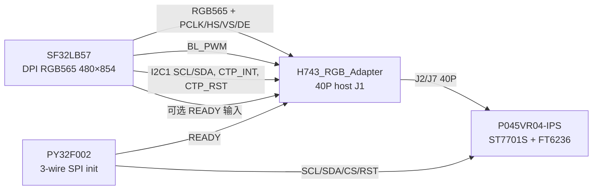

# SF32LB57-P045VR04-IPS

SF32LB57 + P045VR04-IPS（480×854，ST7701S，RGB565，FT6236 触摸）显示工程。

面板的 3 线 SPI 初始化由 `H743_RGB_Adapter` 板上的 PY32F002 完成；SF32LB57
只负责 DPI RGB565 时序、背光（GPIO）、触摸 I2C 和 READY/复位握手。这个分工与
`H743_RGB_Adapter.pdf` 的 “04 - PY32 display initialization” 页一致。



## 1. 目录结构

```
SF32LB57-P045VR04-IPS/
├─ board/sf32lb57-p045vr04/       # 板级定义（基于 sf32lb57-lcd_n16r8_dpi）
│  ├─ hcpu/                       # HCPU board.conf / Kconfig / rtconfig / mem map
│  ├─ acpu/ lcpu/                 # 多核工程占位配置
│  ├─ bsp_*.c board.h bsp_board.h # 从 sf32lb57-lcd_base 复制并按需修改
│  ├─ ptab.json                   # Flash 分区
│  └─ SConscript                  # 编译板级文件 + 面板/触摸驱动
├─ drivers/panel/p045vr04.c       # ST7701S RGB565 DPI 驱动（不做 SPI 初始化）
├─ drivers/touch/ft6236.c         # FT6236 / FT6x36 触摸驱动（12-bit X/Y）
├─ app/project/                   # SiFli/RT-Thread 工程（scons 构建入口）
│  └─ proj.conf                   # RT-Thread + LVGL 选项
├─ app/src/main.c                 # LVGL 8 演示（按钮 / 滑块 / 触摸板）
├─ py32f002/P045VR04_Init/        # 适配板上 PY32F002 的 3 线 SPI 初始化固件
│  ├─ Src/ Inc/                   # ST7701S 初始化表 + 3 线 SPI + READY 握手
│  └─ MDK-ARM/ EIDE/              # 两套工程（共用同一份 Src/Inc）
├─ hardware/adapter-v2/          # H743_RGB_Adapter v2 的 KiCad 源文件
│  ├─ *.kicad_pro/_sch/_pcb      # 原理图(4 页层次) + PCB(78×75mm, 4 层)
│  └─ Adapter.* easyeda_convertlib.* docs/ scripts/
├─ patches/0001-add-p045vr04-panel.patch
├─ patches/0002-lcdc-dpi-linebuf-height.patch
└─ README.md
```

外部依赖（均不入库）：

| 依赖 | 放置位置 |
|---|---|
| [SiFli-SDK](https://github.com/OpenSiFli/SiFli-SDK)（本项目基于 `504eb222`） | 与本工程同级目录，或 `SIFLI_SDK` 指向它 |
| Puya **PY32F0xx_Firmware_V1.5.0**（HAL/CMSIS，仅 PY32 固件需要） | 本仓库根目录（与 `app/` 同级）；`py32f002` 的两个工程按 `../../../PY32F0xx_Firmware_V1.5.0` 引用 |
| Keil MDK + `Puya.PY32F0xx_DFP` 器件包（仅 MDK 工程需要） | 双击固件包 `Packs/MDK/*.pack` 安装 |

SF32 侧构建见第 4 节；PY32 侧构建见 `py32f002/P045VR04_Init/readme.txt`。

## 2. 面板与接口参数

| 项目 | 值 |
|---|---|
| 面板 | P045VR04-IPS，480×854，竖屏原生扫描 |
| 驱动 IC | ST7701S（RGB 接口，COLMOD=0x50 / RGB565） |
| 触摸 | FT6236，I2C 0x38，10-bit 坐标 |
| DPI 像素时钟 | 28 MHz（480×854 约 57.5 Hz） |
| 水平 | HSW=10，HBP=30，HFP=30 |
| 垂直 | VSW=4，VBP=15，VFP=12 |
| 颜色 | RGB565：R3..R7，G2..G7，B3..B7 |
| 背光 | PA_11（GPIO 高=全亮；该 pad 在本芯片上无 GPTIM 功能） |
| 触摸 I2C | I2C1：PA_22=SCL，PA_23=SDA |
| 触摸中断 | PA_20（`TOUCH_IRQ_PIN=20`） |
| 触摸复位 | AW9523 P1_6（`BSP_TP_Reset`） |
| 面板/PY32 复位 | AW9523 P1_7（`BSP_LCD_Reset`） |

> SF32LB57 的 LCDC 只输出 RGB565；下层未用的 R0..R2/G0..G1/B0..B2 由
> 适配器保持低电平，不做 RGB888 还原。

### 2.1 主控与存储（实测确认）

本板是 **SF32LB57GYD7N6**（QFN80）的 N16R16 变体，不是 N16R8：

| MPI | 器件 | 地址窗口 | 说明 |
|---|---|---|---|
| MPI1 | PSRAM 16 MB（OPSRAM，mode 3） | 0x60000000 | 双 RGB565 framebuffer 放在这里 |
| MPI2 | NOR Flash 16 MB | 0x12000000 | ftab / bootloader / 应用 |
| MPI3 | 无 | 0x14000000 | 未贴片，读回恒为 0xCC |

`board/sf32lb57-p045vr04/hcpu/Kconfig.board` 必须 `select SOC_SF32LB57GYD7N6`；
选成 `SOC_SF32LB57EYBBN6`（N16R8）会让构建把应用放到不存在的 MPI3，
表现为 `sftool write_flash` 返回成功但读回全 0xCC、板子不启动。

Flash 布局（`ptab.json` → 生成的 `ftab.bin`）：

| 区域 | 地址 |
|---|---|
| ftab | 0x12000000 |
| bootloader | 0x12010000（运行地址 0x20020000） |
| 应用 main | 0x12020000 |

## 3. 与 H743_RGB_Adapter 的接线

适配器 J1 是 **H743 板 LCD 座**的线序，不是 57 DevKit FPC1 的“正点原子
40P RGB”线序，两者不能直接对插。需要用一块 40P 0.5mm 转接板/交叉 FPC
按下表改线（或飞线）。J1 的完整定义见 `H743_RGB_Adapter.pdf` 第 1 页。

### 3.1 RGB565 与同步信号

| H743 适配器 J1 | 信号 | 57 DevKit FPC1（正点原子 40P） |
|---|---|---|
| 6 | R3 | 6 |
| 7 | R4 | 7 |
| 8 | R5 | 8 |
| 9 | R6 | 9 |
| 10 | R7 | 10 |
| 14 | G2 | 18 |
| 15 | G3 | 19 |
| 16 | G4 | 21 |
| 17 | G5 | 22 |
| 18 | G6 | 23 |
| 19 | G7 | 24 |
| 24 | B3 | 28 |
| 25 | B4 | 29 |
| 26 | B5 | 30 |
| 27 | B6 | 31 |
| 28 | B7 | 32 |
| 30 | PCLK | 33（PA_48） |
| 31 | HSYNC | 34（PA_49） |
| 33 | DE | 35（PA_50） |
| 32 | VSYNC | 36（PA_51） |

### 3.2 控制信号

| H743 适配器 J1 | 信号 | 57 DevKit 侧 | 固件配置 |
|---|---|---|---|
| 34 | BL_PWM | FPC1 PA_11（GPIO，无定时器功能） | `BSP_LCD_Backlight()` |
| 35 | CTP_RST | AW9523 P1_6 / 触摸座 RST | `BSP_TP_Reset()` |
| 36 | CTP_SDA | PA_23（I2C1_SDA） | `TOUCH_DEVICE_NAME="i2c1"` |
| 38 | CTP_SCL | PA_22（I2C1_SCL） | 同上 |
| 39 | CTP_INT | PA_20 | `TOUCH_IRQ_PIN=20` |
| 37 | H_LCD_READY | 任选空闲 GPIO | `CONFIG_LCD_READY_PIN=<pin>`；默认 -1 |
| 40 | H_NRST | FPC1 LCD_RST / AW9523 P1_7 | `BSP_LCD_Reset()` 释放 PY32 |

> 57 DevKit FPC1 的 37~40 脚在原理图上由 `BL_PWM / IOEX_CTP_RST /
> I2C_SDA / I2C_SCL / IOEX_LCD_RST` 五选四，具体顺序以 57x LCD-DevKit
> 原理图和 `ioconfig-08192026.xlsx` 为准。固件侧功能是固定的：PA_11 背光、
> PA_22/PA_23 为 I2C1、AW9523 P1_6 为触摸复位、P1_7 为面板/PY32 复位。
>
> 如果不接 READY，驱动会固定等待 1000 ms（PY32 约 500 ms 完成初始化）。
> 如果接 READY，在 `board.conf` 里加 `CONFIG_LCD_READY_PIN=xx` 重新编译。

**背光只能是 GPIO。** 57 的 pad 功能表里 `PAD_PA11` 只有
`GPIO_A11 / MPI3_CS2 / SD1_DIO1 / AUD_CLK_EXT`，**没有 GPTIM**；把它
`HAL_PIN_Set(..., GPTIM2_CH2, ...)` 会直接返回 -1，引脚停在复位态，
背光升压 SY7200 的 EN/PWM 悬浮，屏幕就偏暗。因此板级改为
`BSP_GPIO_Set(PA11, 0/1)`，与正点原子 H743 例程（PB5 直接拉高）等价。
`LCD_USING_PWM_AS_BACKLIGHT` 也已从面板 Kconfig 里去掉。

**RGB565 只走高 16 位，且 LCDC 的 16 位模式是低位对齐。** 适配器把
R0..R2 / G0..G1 / B0..B2 直接接地，只透传 R3..R7、G2..G7、B3..B7；而
LCDC 在 RGB565（`DPI_LCD_FORMAT=1`）下驱动的是 **R0..R4 / G0..G5 /
B0..B4**。因此 pad 上挂的功能要整体左移 3/2/3：

| FPC1（面板） | 57 pad | mux 的功能 |
|---|---|---|
| R3..R7 | PA_27..PA_31 | `LCDC1_DPI_R0`..`R4` |
| G2..G7 | PA_37..PA_42 | `LCDC1_DPI_G0`..`G5` |
| B3..B7 | PA_52、PA_53、PA_54、PA_46、PA_47 | `LCDC1_DPI_B0`..`B4` |
| R0..R2 / G0..G1 / B0..B2 | PA_24..PA_26 / PA_32..PA_33 / PA_43..PA_45 | 不用，保持 GPIO 输入 |

直连（`R0..R7` 一一对应）的写法会让每个通道只剩下中间几位，整屏发暗但
颜色不翻转——很容易被误判成背光不足。厂商自己的 LB57 DPI 参考板
（`sf32lb57-lcd_*_dpi`、`dpi-hdk_*_n16_dpi`）用的都是 24 位
`HTM_H070A20`，`SetColorMode()` 是空函数，RGB565 这条路没人验证过，
所以不能照抄它们的 mux。

时序脚：CLK=PA_48、HSYNC=PA_49、VSYNC=PA_51、DE=PA_50；
BL_PWM=PA_11（GPIO）；TP_INT=PA_20、TP_SDA/SCL=I2C1(PA_23/PA_22)、
TP_RST=AW9523 P1_6、LCD_RST=AW9523 P1_7。pad 对应关系与
`SF32LB57-DevKit-LCD-V1` 原理图（SCH_V1，2026-11-08）逐脚核对过。

### 3.3 电源

- 适配器 J1 的 +5V（1/2 脚）给适配器上的 SY7200 背光升压和 ME6211 3.3V
  LDO 供电；57 DevKit FPC1 的 1 脚也是 5V。
- 57 DevKit 与适配器必须共地；触摸和面板逻辑均为 3.3V。

## 4. 构建

### 4.1 准备 SDK

工程默认使用与当前目录同级的 `SiFli-SDK`：

```
Documents/project/
├─ SiFli-SDK/                     # https://github.com/OpenSiFli/SiFli-SDK
└─ SF32LB57-P045VR04-IPS/         # 本工程
```

面板选择项需要给 SDK 打一个很小的 Kconfig 补丁（只改
`customer/boards/Kconfig_lcd`，增加 `LCD_USING_P045VR04_IPS_DPI` 及
480×854 分辨率默认值）：

```bash
cd ../SiFli-SDK
git apply ../SF32LB57-P045VR04-IPS/patches/0001-add-p045vr04-panel.patch
```

当前工作区的 `SiFli-SDK` 已经应用该补丁。板级文件和驱动不在 SDK 内，
构建时通过 `--board_search_path` 引用，升级 SDK 不会覆盖它们。

### 4.2 激活 SiFli 编译环境

使用 SDK 自带的环境管理器（`uv`）激活 gcc 工具链和 scons：

```bash
cd ../SiFli-SDK
. ./export.sh
```

或在 PowerShell 中：

```powershell
cd ..\SiFli-SDK
. .\export.ps1
```

> 如果 `export.sh` 在当前 Git Bash 下因 `uv` 的 Windows 路径报
> `\\?\...` 错误，可直接使用 SDK 环境里已经安装好的
> `...\.sifli\envs\default\<hash>\python\Scripts\scons.exe` 和
> `...\.sifli\tools\arm-none-eabi-gcc\14.2.1\bin`，并设置
> `SIFLI_SDK`、`RTT_CC=gcc`、`RTT_EXEC_PATH`。本工程已用这种方式
> 完成编译验证。

### 4.3 编译

```bash
cd SF32LB57-P045VR04-IPS/app/project
scons --board=sf32lb57-p045vr04 \
      --board_search_path=../../board -j 8
```

或直接运行工程根目录的脚本：

```powershell
.\build.ps1
```

```bash
./build.sh
```

`build.ps1` 已在 PowerShell 下完成端到端验证；`build.sh` 请在
Git Bash 中使用（WSL 的 bash 看不到 Windows 的 `.sifli` 环境）。
两个脚本都会在未激活环境时自动查找 `~/.sifli` 下的 scons 和 gcc。

输出在 `app/project/build_sf32lb57-p045vr04_hcpu/`：

| 文件 | 说明 |
|---|---|
| `main.bin` | 应用镜像（烧到 0x12020000） |
| `bootloader/bootloader.bin` | bootloader 镜像（烧到 0x12010000） |
| `ftab/ftab.bin` | 分区表，内含 bootloader/app 的地址与长度（烧到 0x12000000） |
| `sftool_param.json` | sftool UART 下载参数（地址已按 N16R16 生成） |

编译后的关键配置可在 `build_sf32lb57-p045vr04_hcpu/rtconfig.h` 中确认：

```
#define LCD_HOR_RES_MAX 480
#define LCD_VER_RES_MAX 854
#define BSP_LCDC_USING_DPI 1
#define BSP_USING_RAMLESS_LCD 1
#define BSP_USING_TOUCHD 1
#define TOUCH_IRQ_PIN 20
```

### 4.4 烧录（UART / sftool，实测通过）

`download.bat` 走 J-Link，本工程不用；用 sftool 从 CH343P 的串口下载即可。

1. USB Type-C 连接 57 DevKit 的 **USB-to-UART**（CH343P，本机为 COM8）；
2. 按 57 DevKit 用户指南进入下载模式（BOOT 跳线），复位；
3. 在 `app/project/build_sf32lb57-p045vr04_hcpu/` 下执行：

```bat
sftool -c SF32LB57 -m nor -p COM8 write_flash --verify ^
    bootloader\bootloader.bin@0x12010000 ^
    main.bin@0x12020000 ^
    ftab\ftab.bin@0x12000000
```

也可以直接用生成的参数文件：

```bat
sftool -c SF32LB57 -m nor -p COM8 config sftool_param.json
```

4. 去掉 BOOT 跳线，复位（或重新上电）从 Flash 启动；应用的 RT-Thread
   控制台在 **UART1 / 1000000 8N1**，即同一个 CH343 口。

> 若 `write_flash` 打印 "verify failed"：先确认 `sftool_param.json` 里的
> 三个地址是 0x1200_0000 段（N16R16/MPI2），而不是 0x1400_0000（N16R8/MPI3）。
> 地址错了写入会被静默丢弃，读回全是 0xCC。

独立校验（不经 sftool 的 CRC 逻辑）：

```bat
sftool -c SF32LB57 -m nor -p COM8 read_flash ftab_rb.bin@0x12000000:0x2C18
sftool -c SF32LB57 -m nor -p COM8 read_flash main_rb.bin@0x12020000:287580
fc /b ftab_rb.bin ftab\ftab.bin
fc /b main_rb.bin main.bin
```

## 5. 演示现象（LVGL 8）

`app/src/main.c` 是一个最小 LVGL 8 应用（**不**依赖 SDK 的
`GUI_APP_FRAMEWORK`）：

- 顶部标题 + 参数行；
- `COUNT n` 按钮：点击计数（验证触摸点按）；
- 滑块 + 进度条联动（验证连续拖动）；
- `TOUCH PAD` 区域：红点跟随手指，右上角显示 `x=N y=N`；
- 串口同步打印 `[app] touch down at (x,y)` / `[app] button clicked: n`。

上电日志顺序：`drv.lcd ... open done` → `drv_lcd_fb_init` →
`TOUCH ... found driver ft6236` → `[littlevgl2rtt] Welcome` →
`[app] ui ready: 480x854` → `set brightness 100` → `display on`。

### 5.1 显示 / 触摸通路

| 环节 | 实现 |
|---|---|
| LVGL 库 | `PKG_USING_LITTLEVGL2RTT` + `LVGL_V8`，`LV_COLOR_DEPTH=16` |
| 显示 | SDK `middleware/lvgl/lv_drivers/lv_lcd.c` 操作 `lcd` 设备；`LCD_FB_USING_AUTO` 在 ramless DPI 上选 `TWO_UNCOMPRESSED`，两块整屏 PSRAM 缓冲（各 819,840 B，位于 0x60000000 的 `.l2_non_ret_bss_frambuf`） |
| 渲染加速 | `LV_USE_GPU_SIFLI_EPIC` 由 `lv_conf_sifli.h` 强制打开（前提 `BSP_USING_EPIC=y`） |
| 触摸 | SDK `drv_touch` + 本工程 `drivers/touch/ft6236.c`（12 bit 坐标、480×854、无镜像） |
| LVGL 输入设备 | SDK `lv_touch.c`，从名为 `touch` 的设备读 `struct touch_message` |

### 5.2 LVGL 配置里的必选项（都踩过）

`app/project/proj.conf` 中以下几项不是可选的：

| 选项 | 原因 |
|---|---|
| `CONFIG_RT_USING_MEMHEAP=y` | `middleware/lvgl/app_mem.c` 用到 `rt_memheap_*` |
| `# CONFIG_LV_USING_EXT_RESOURCE_MANAGER is not set` | 打开会编译 `lv_ext_resouce`，它要求 `lang_pack.h`（属于 app 框架） |
| v8 下 LVSF 强制启用 | `lv_conf_sifli.h` 里 `DISABLE_LVGL_V9` ⇒ `LV_USE_LVSF`，所以必须选上主题字体 16/20/24/28/36（`LV_HOR_RES_MAX>350` 分支） |
| 必须调用 `lv_ex_data_pool_init()` | `lv_refr.c` 每次刷新都会调 `lv_ex_process_data()`；`data_sema` 未初始化时第一次刷新就断言在 `rt_sem_take` |

触摸注意：SDK 自带的 `customer/peripherals/touch_panel/ft6336/ft6336.c`
把量程写死成 240×240、只读低字节（`FT_P1_XL`/`FT_P1_YL`），在 480×854 上不可用。
本工程用自己的 `drivers/touch/ft6236.c`：`TOUCH_DEVICE_NAME="i2c1"`，
`BSP_USING_TOUCHD=y` 时编入，通过 `INIT_COMPONENT_EXPORT` 注册进 `drv_touch`
的驱动表，因此 LVGL 侧无需任何改动。若实测坐标方向不符，改
`ft6236_correct_pos()` 里的镜像/交换即可。

## 6. 与 H743 工程的差异

| 项目 | `正点原子h743-P045VR04-IPS` | 本工程 |
|---|---|---|
| 主控 | STM32H743 LTDC | SF32LB57 LCDC DPI |
| 面板初始化 | PY32F002 3-wire SPI | 同一块适配器上的 PY32F002 |
| 颜色 | RGB565 | RGB565 |
| 触摸 | H743 软件 I2C + FT5206 | SF32 I2C1 + FT6236 |
| 背光 | PB5（GPIO 拉高） | PA_11（GPIO 拉高） |
| READY | PG3 输入 | 可选 GPIO（默认固定延迟） |

## 7. 注意事项

1. **不要**在 SF32 侧调用 `BSP_LCD_Reset()` 去复位面板：适配器 J1 的
   RESET 脚接的是 PY32 的 NRST，拉低会把初始化 MCU 一起复位。当前
   `p045vr04.c` 的 `LCD_Init()` 不调用它，只等待 READY/固定延迟。
2. 适配器上的 PY32 必须烧录 **P045VR04 对应** 的固件（`py32f002/
   P045VR04_Init/`，`PANEL_MAP_P045VR04`），否则面板不会出图。
3. RGB565 是硬件决定的：适配器只连了 R3..R7/G2..G7/B3..B7，PY32 也把
   COLMOD 设为 0x50。应用层不要切到 RGB888。
4. 57 DevKit FPC1 的 37~40 脚定义请以实物原理图为准；如果线序与上表
   不同，只需改转接板/飞线，固件侧的 PA_11、PA_22、PA_23、PA_20、
   AW9523 P1_6/P1_7 不变。
5. 如果使用 57 DevKit 自带的其他 RGB 屏（如 HTM-H070A20），把
   `board.conf` 的 `CONFIG_LCD_USING_P045VR04_IPS_DPI=y` 换成对应面板
   选项即可；本工程的 `p045vr04` 驱动只适用于 480×854 ST7701S。

## 8. 已验证

工具链：SiFli SDK `504eb222`、arm-none-eabi-gcc 14.2.1、scons 4.10.1，
`build.ps1` 在 PowerShell 下端到端通过。

硬件配置（实测确认）：SF32LB57GYD7N6 / N16R16，`CONFIG_SOC_SF32LB57GYD7N6=y`、
`BSP_QSPI1_MODE=3`（PSRAM 16 MB）、`BSP_QSPI2_MODE=0`（NOR 16 MB）、
`BSP_ENABLE_MPI3` 关闭。

| 项目 | 结果 |
|---|---|
| 镜像 | `main.bin` 554,364 B（含 LVGL 8 + LVSF + 主题字体），`ftab` base 0x12000000，应用 0x12020000 |
| 烧录 | `sftool -c SF32LB57 -m nor -p COM8 write_flash --verify`，三块镜像逐字节读回一致 |
| 显示 | DPI RGB565，480×854；`Found lcd p045vr04 id:4585h` → `display on` |
| DPI 颜色 | 16 位输出为低位对齐，pad 上的功能左移 3/2/3 后才与适配器的高 16 位对齐（见 3.2） |
| 背光 | PA_11 只能当 GPIO（无 GPTIM 功能），`BSP_LCD_Backlight()` 拉高升压 EN |
| LVGL | 两块整屏 PSRAM 缓冲 @0x60000000（各 819,840 B）、EPIC 加速、`[app] ui ready: 480x854` |
| 触摸 | `ft6236` 被探测到并注册为 `touch` 设备；点按/拖动均有串口日志，坐标落在手指位置 |

已知待做（非阻塞）：若要更顺滑的拖动，可把 `LV_INDEV_DEF_READ_PERIOD` 从
16 ms 调到 10 ms；需要 FPS 叠加显示时把 `CONFIG_LV_USE_PERF_MONITOR` 打开即可。
